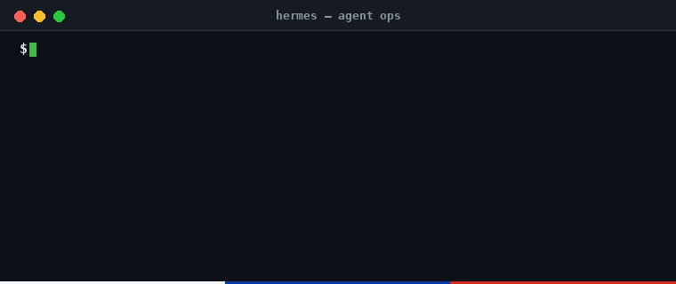
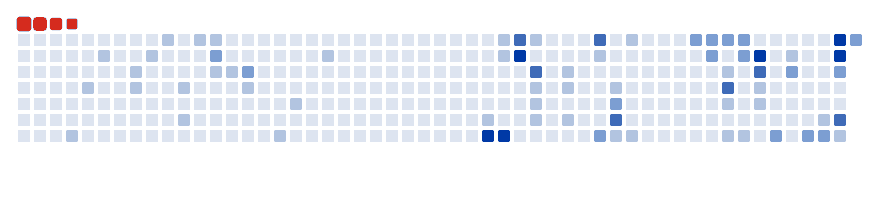

  

  
  
  

 

| 
**47** repositories
 | 
**982** commits
 | 
**74** PR
 | 
**34** stars
 |
|:---:|:---:|:---:|:---:|

## 👋 Who I am

**Fullstack developer (TypeScript) · AI agents & integrations · enterprise automation**

13+ years in software. Frontend — Angular since its first version (1.x → modern releases, RxJS, Angular Material, Nx monorepos). Backend — Node.js (NestJS, Express, Fastify), API and database schema design. Alongside that — enterprise automation: MS SQL Server, C#, legacy Visual FoxPro, XML and EDI integrations.

A separate line of work — **AI/LLM**: agent integrations (plugins and bridges between messengers and an AI agent), local inference (Ollama, llama.cpp), MCP tools, infrastructure built for AI workloads.

📍 Kremyonki, Kaluga region (south of Moscow area) · 🎓 MGUPI, Information Systems in Economics, 2009 · 🗣️ Russian (native), English (B2)

---

<table>
<tr>
<td valign="top" width="50%">

## 💼 What I'm looking for

A remote role in a product team with a multi-year horizon — growth along the technical track, not a move into management.

| Profile | What I deliver |
|---|---|
| **Fullstack TS** | Angular + Node.js: interfaces, APIs, integrations |
| **Backend** | Node.js / NestJS: REST and event-driven APIs, DB schemas, Redis |
| **AI/LLM** | Agent integrations, Bot APIs, MCP, local inference |
| **Frontend** | Angular 1.x → modern, Nx, RxJS, WebRTC/HLS players |

**Format:** remote first · Moscow / Moscow region — only if the employer fully covers relocation · business trips — fine

**What I'm good at** 
• reading and taming someone else's legacy code 
• shipping a feature end to end: frontend, backend, deploy, monitoring 
• seeing the whole system — network, server, app, hardware

</td>
<td valign="top" width="50%">

## 🛠 Stack

    
  

**Languages** — TypeScript · Python · JavaScript · C# · Go · C++ · MS SQL · FoxPro 
**Backend** — Node.js · NestJS · Express · FastAPI 
**Frontend** — Angular 1.x → · RxJS · React · Next.js · Svelte · Ionic 
**Data** — PostgreSQL · MySQL · MongoDB · Redis · Qdrant 
**AI/LLM** — MCP · Ollama · llama.cpp · PyTorch · TensorFlow · OpenCV 
**Infrastructure** — Docker · nginx · MediaMTX · OpenWrt · Linux 
**Embedded** — Arduino · Raspberry Pi · serial 
**Messengers** — Telegram · MAX · VK Bot API

</td>
</tr>
</table>

---

## 🏆 Projects

<table>
<tr>
<td align="center" width="50%">

### 🤖 [max-hermes-plugin](https://github.com/RuslanStrogov/max-hermes-plugin) ★9

 

Hermes Agent plugin for the MAX Bot API: webhook, commands, inline keyboards, markdown, images. Open source.

</td>
<td align="center" width="50%">

### 🌉 [max-hermes](https://github.com/RuslanStrogov/max-hermes) ★8

  

Bridge between the MAX Bot API and an AI agent: long polling + webhook, Docker, systemd.

</td>
</tr>
<tr>
<td align="center" width="50%">

### ⚡ [max-openclaw](https://github.com/RuslanStrogov/max-openclaw) ★4

 

TypeScript MAX channel plugin for the OpenClaw AI agent: Bot API, webhooks, inline keyboards, CI/CD pipeline.

</td>
<td align="center" width="50%">

### 📡 [com-pinger](https://github.com/RuslanStrogov/com-pinger) ★4

 

Node.js ↔ Arduino over serial: RTT measurement, auto-reconnect, CLI args. Embedded skills, plain to see.

</td>
</tr>
<tr>
<td align="center" width="50%">

### 🎛️ [robotics-core-ui](https://github.com/RuslanStrogov/robotics-core-ui) ★3

  

Nx monorepo: speech synthesis and recognition, load balancing, database layer.

</td>
<td align="center" width="50%">

### 🎰 [brom-casino](https://github.com/RuslanStrogov/brom-casino)

   

Game platform monorepo: NestJS + Next.js, PostgreSQL, Redis, Telegram Mini App, TON, Turborepo.

</td>
</tr>
<tr>
<td align="center" width="50%">

### 🧩 [chrome-roonyx](https://github.com/RuslanStrogov/chrome-roonyx) ★1

 

Chrome extension: content blocking and filtering on Manifest V3.

</td>
<td align="center" width="50%">

### 🤖 [robot-catty](https://github.com/RuslanStrogov/robot-catty) ★1

  

Raspberry Pi + Arduino robot with a web control UI: servos, RGB LEDs, serial link, WebSocket.

</td>
</tr>
</table>

---

## 🧭 Technologies and areas

**47 repositories** in total — 23 public and 24 private. The private ones are production and infrastructure work: code is closed, the stack is the same.

| Area | Technologies | What's been built |
|---|---|---|
| **AI agents & bots** | Python, TypeScript, Bot APIs (Telegram / MAX / VK), webhooks, long polling, inline keyboards, Docker, systemd | Plugins and bridges between messengers and an AI agent: [max-hermes-plugin](https://github.com/RuslanStrogov/max-hermes-plugin) ★9 · [max-hermes](https://github.com/RuslanStrogov/max-hermes) ★8 · [max-openclaw](https://github.com/RuslanStrogov/max-openclaw) ★4 · [max-shared](https://github.com/RuslanStrogov/max-shared) · [awesome-max-integrations](https://github.com/RuslanStrogov/awesome-max-integrations) |
| **Streaming & video** | TypeScript, Wowza, RTSP / HLS / WebRTC, MediaMTX, go2rtc, Angular | Streaming control panel, multi-camera operator dashboards, players with bitrate switching and multi-audio |
| **Infrastructure & networks** | Linux, Docker, nginx, OpenWrt, WireGuard / L2TP, PowerShell, Bash, self-hosted runners | Hosting cluster with 30+ sites, network inventory and monitoring, router and Windows configs, backups and watchdogs |
| **Data & automation** | Python, TypeScript, PostgreSQL, MySQL, MongoDB, Redis, Qdrant, scraping | Marketplace margin monitoring, social-media publishing, AI/ML market research — [super-ai-ru](https://github.com/RuslanStrogov/super-ai-ru) |
| **Engineering frontend** | Angular 1.x → modern, NestJS, Nx, RxJS, Angular Material, Ionic, PostgreSQL | [robotics-core-ui](https://github.com/RuslanStrogov/robotics-core-ui) ★3 · [taxi-api-web-mobile](https://github.com/RuslanStrogov/taxi-api-web-mobile) · [nx-nest-angular-ionic](https://github.com/RuslanStrogov/nx-nest-angular-ionic) · [mi-band-watchface-editor-material](https://github.com/RuslanStrogov/mi-band-watchface-editor-material) · [brom-casino](https://github.com/RuslanStrogov/brom-casino) |
| **Chrome extensions** | JavaScript, TypeScript, Manifest V3 | [chrome-roonyx](https://github.com/RuslanStrogov/chrome-roonyx) — content filtering; a second extension (AI new-tab panel) is private |
| **Embedded & hardware** | C/C++, Arduino, Raspberry Pi, serial, Python | [com-pinger](https://github.com/RuslanStrogov/com-pinger) ★4 · [robot-catty](https://github.com/RuslanStrogov/robot-catty) ★1 |

---

<table>
<tr>
<td valign="top" width="58%">

## 💼 Experience

<b>Software Engineer</b> — POZ Progress JSC, Protvino Sep 2026 — present

Enterprise automation inside the MES/ACS loop:
- **MS SQL Server** — table and query design, query optimization
- legacy **Visual FoxPro and C#** — reading foreign code, delivering features, refactoring
- integrations with external systems — Kontur Diadok EDI document exchange, XML
- documentation and company engineering standards

<b>Head of IT Department</b> — IQ Region Jul 2025 — Mar 2026

Systems integration and software development company:
- IT strategy and internal systems
- development process: task setting, acceptance, releases
- team and contractors, budgets and procurement
- technology choice and quality control

<b>Engineer</b> — BIEM Group Jul 2024 — Jul 2025

Electronics and instrumentation:
- technical documentation and measurement equipment
- participation in the company's engineering projects

<b>Software Developer</b> — Strela Design Bureau Nov 2022 — Apr 2024

Defence and aerospace industry:
- software development on classified topics (**NDA**)
- industry standards, design reviews and sign-off

<b>Lead Frontend Developer</b> — Projects & Web Innovations Jun 2021 — Dec 2022

Control panel for a streaming platform (**Wowza Streaming Engine**):
- Angular frontend: live channels, broadcast scheduling, stream management
- **WebRTC / RTMP / HLS** players with bitrate switching and multi-audio
- layer-overlay configurator, embeddable widgets for client sites
- architecture and API (**Swagger**), backend on **Node.js / Express / Mongo**
- tasks in **Jira**, close collaboration with design

<b>Own business</b> — BR-DESIGN Jul 2021 — Feb 2024

- client websites and landing pages, design and markup
- hosting server cluster on a high-speed uplink — **30+ client sites**, still running
- end to end: brief, mockups, deployment, support

<b>Software Engineer</b> — transport monitoring Jun 2017 — Apr 2018

Transport monitoring system:
- **Angular 2 + Mapbox GL + Three.js**, real time over **WebSocket**
- backend **Loopback + MySQL**
- tracks and statuses on the map, movement history

<b>Lead Frontend Developer</b> — Sitronics KASU JSC Nov 2014 — May 2016

Situation centre:
- **20,000+ objects** on a **Leaflet canvas** map without frame drops
- **PTZ camera** control, video bound to objects
- event animation and visualisation with **Fabric.js**

<b>2009 — 2014</b> — from web design to IT director

- **2011–2014 — IT director**: infrastructure, procurement, team
- **2010–2011 — web programmer**
- **2009–2010 — web designer**
- alongside: **embedded** — microcontrollers, Arduino/Raspberry Pi, on-board hardware, on-site commissioning, 3D printing

</td>
<td valign="top" width="42%">

## 📄 Resumes on hh.ru

**13 years 6 months** of experience · 14 entries 
**28 skills** · visible to employers

**Active resumes** — open inside an hh.ru account:

• [Fullstack developer](https://hh.ru/resume/806cdf03ff1033cacf0039ed1f6961667a4957) • [Backend Node.js / NestJS](https://hh.ru/resume/a9852280ff116f2f990039ed1f514947566c51) • [AI/LLM engineer](https://hh.ru/resume/80e49314ff116f2ff70039ed1f6f3878646234) • [Frontend Angular](https://hh.ru/resume/77e0c2f9ff116f30150039ed1f4a4441674178) • [Software engineer · integrations, embedded](https://hh.ru/resume/19266b3dff116f30370039ed1f316d5830786d)

📍 Kremyonki (south of Moscow area) · remote 
Moscow / Moscow region — only with full relocation covered by the employer 
🎓 MGUPI, Information Systems in Economics, 2009 
🗣️ Russian (native), English (B2) 
🖼️ 6 portfolio works on hh 
🔐 resume links open inside an hh.ru account

</td>
</tr>
</table>

---

## 🎬 How my setup runs

  
   
  AI agents, bots and local inference — the everyday loop: gateway status to push into main

---

## 🤝 Get in touch

  
  
  
  
  
  

  
  
  

---

## 📊 Stats

  
  

  

  <picture>
    <source media="(prefers-color-scheme: dark)" srcset="https://raw.githubusercontent.com/RuslanStrogov/RuslanStrogov/output/snake-dark.gif"/>
    
  </picture>
   
  🐍 snake animation over real contributions — rebuilt by CI every day

---

  

  
  

  
   
  🤷‍♂️ When the code compiles on the first try

 

  
  🎨 <a href="https://br-design.ru/">BR-DESIGN</a> · 🤖 <a href="https://t.me/brombombom">BROM AI</a>

